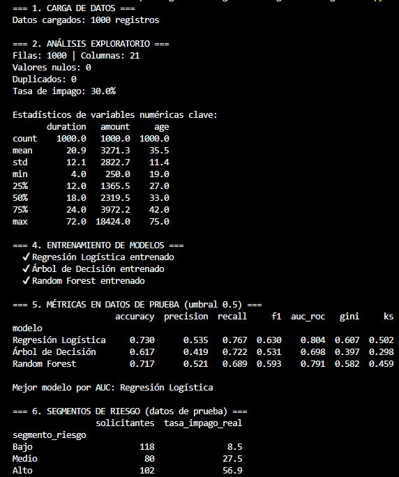
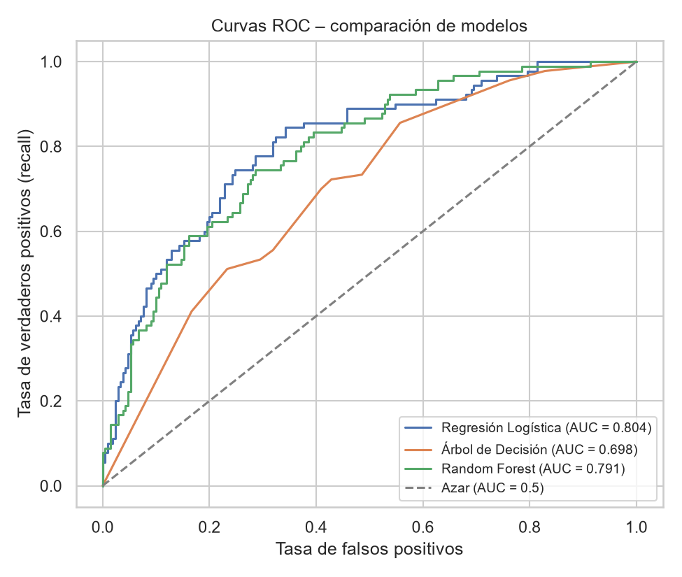
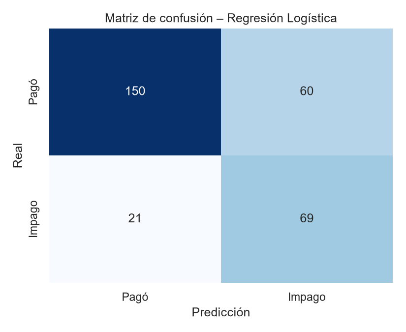
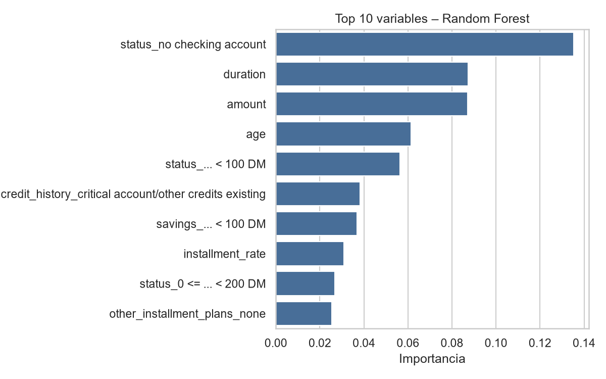
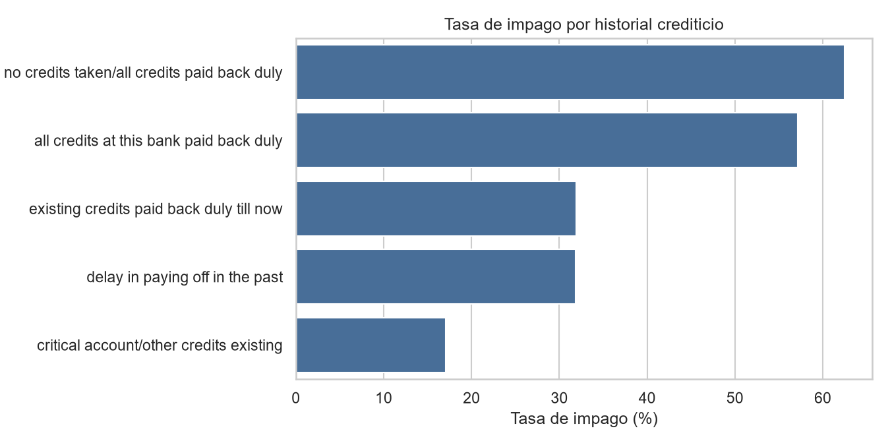

# Modelo de Riesgo de Crédito – Predicción de Impago

Proyecto de análisis de datos y Machine Learning que estima la **probabilidad de que un solicitante no pague su crédito**, compara tres modelos de clasificación y traduce el resultado en **segmentos de riesgo** útiles para la toma de decisiones de negocio.

**Herramientas:** Python · pandas · scikit-learn · matplotlib · seaborn

---

## Objetivo

Una institución financiera quiere aprobar créditos minimizando el riesgo. Con datos históricos de 1,000 solicitudes, el objetivo es:

1. Identificar qué características se asocian con el impago (EDA).
2. Entrenar modelos predictivos que asignen un **score de probabilidad de impago**.
3. Evaluarlos con métricas de clasificación y las métricas estándar de riesgo de crédito (**AUC, Gini y KS**).
4. Segmentar a los solicitantes en riesgo **Bajo, Medio y Alto**.

## Datos

- **Fuente:** German Credit Data (Hofmann, 1994), repositorio UCI.
- **Tamaño:** 1,000 solicitudes, 20 variables + variable objetivo.
- **Variable objetivo (`impago`):** 1 = mal pagador (30 %), 0 = buen pagador (70 %).
- **Variables principales:** estado de la cuenta (`status`), duración (`duration`), monto (`amount`), historial crediticio (`credit_history`), ahorros (`savings`), edad (`age`), entre otras.
- Sin valores nulos ni duplicados.

## Metodología

1. **EDA:** revisión de nulos, duplicados, distribución y tasa de impago por segmento.
2. **Preprocesamiento:** `OneHotEncoder` para variables categóricas y `StandardScaler` para numéricas, dentro de un `Pipeline` (evita fuga de información).
3. **División:** 70 % entrenamiento / 30 % prueba, **estratificada** para conservar la proporción de impagos.
4. **Desbalance de clases:** `class_weight="balanced"`, para que el modelo no ignore a los malos pagadores.
5. **Modelos:** Regresión Logística, Árbol de Decisión y Random Forest.
6. **Evaluación** en datos de prueba que el modelo nunca vio.

## Resultados

| Modelo | Accuracy | Precision | Recall | F1 | AUC-ROC | Gini | KS |
|---|---|---|---|---|---|---|---|
| **Regresión Logística** | 0.730 | 0.535 | **0.767** | **0.630** | **0.804** | **0.607** | **0.502** |
| Árbol de Decisión | 0.617 | 0.419 | 0.722 | 0.531 | 0.698 | 0.397 | 0.298 |
| Random Forest | 0.717 | 0.521 | 0.689 | 0.593 | 0.791 | 0.582 | 0.459 |

**Mejor modelo: Regresión Logística** (AUC 0.80, KS 0.50). Además de tener el mejor desempeño, es el más fácil de interpretar y explicar, algo muy valorado en riesgo de crédito por temas regulatorios.

### Segmentación de riesgo (datos de prueba)

| Segmento | Solicitantes | Tasa real de impago |
|---|---|---|
| Bajo (prob. < 30 %) | 118 | 8.5 % |
| Medio (30–60 %) | 80 | 27.5 % |
| Alto (> 60 %) | 102 | 56.9 % |

El modelo separa bien a los clientes: el segmento **Alto** tiene **casi 7 veces más impago** que el **Bajo**. Con esto el negocio podría aprobar automáticamente el segmento Bajo, revisar manualmente el Medio y pedir garantías o rechazar el Alto.

### Ejecución del modelo



### Gráficas

| Curvas ROC | Matriz de confusión |
|---|---|
|  |  |

| Variables más importantes | Impago por historial crediticio |
|---|---|
|  |  |

## Hallazgos principales

- **No tener cuenta de cheques, la duración y el monto del crédito** son las variables más influyentes.
- Créditos más largos y de mayor monto se asocian con más impago.
- **Dato curioso:** en este dataset, los clientes con historial "crítico" muestran *menos* impago que los que "pagaron todo a tiempo". Es un resultado contraintuitivo que la literatura atribuye a errores de codificación del dataset original (Grömping, 2019). Recordatorio de que siempre hay que validar los datos antes de confiar en un modelo.

## Glosario de métricas

- **Precision:** de los que el modelo marcó como impago, cuántos realmente lo fueron.
- **Recall:** de todos los impagos reales, cuántos detectó el modelo. En crédito suele importar más, porque un impago no detectado cuesta dinero.
- **F1:** balance entre precision y recall.
- **AUC-ROC:** capacidad de ordenar a los clientes de menor a mayor riesgo (0.5 = azar, 1 = perfecto).
- **Gini:** `2 × AUC − 1`; métrica estándar en la industria de crédito.
- **KS (Kolmogorov-Smirnov):** máxima separación entre las distribuciones de score de buenos y malos pagadores. Arriba de 0.40 se considera bueno.

## Estructura del proyecto

```
riesgo-credito-german/
├── data/german_credit.csv          # datos (se descargan solos si no existen)
├── src/modelo_riesgo_credito.py    # script principal
├── images/                         # gráficas generadas
├── outputs/
│   ├── metricas_modelos.csv        # tabla de métricas
│   └── scores_prueba.csv           # probabilidad y segmento de cada solicitante
├── requirements.txt
└── README.md
```

## Cómo ejecutarlo

```bash
pip install -r requirements.txt
python src/modelo_riesgo_credito.py
```

## Próximos pasos

- Ajustar el umbral de decisión según el costo de negocio (un impago cuesta más que rechazar a un buen cliente).
- Validación cruzada y ajuste de hiperparámetros.
- Construir una *scorecard* con WoE/IV, el formato tradicional en bancos.
- Cargar los scores a MySQL y visualizarlos en un dashboard de Power BI.

## Referencias

Grömping, U. (2019). *South German credit data: Correcting a widely used data set* (Reports in Mathematics, Physics and Chemistry, Report 4/2019). Beuth University of Applied Sciences Berlin.

Hofmann, H. (1994). *Statlog (German credit data)* [Conjunto de datos]. UCI Machine Learning Repository. https://doi.org/10.24432/C5NC77

Pedregosa, F., Varoquaux, G., Gramfort, A., Michel, V., Thirion, B., Grisel, O., Blondel, M., Prettenhofer, P., Weiss, R., Dubourg, V., Vanderplas, J., Passos, A., Cournapeau, D., Brucher, M., Perrot, M., & Duchesnay, É. (2011). Scikit-learn: Machine learning in Python. *Journal of Machine Learning Research, 12*, 2825–2830.

---

**Autor:** Juan Antonio Delgado Hinojosa · [GitHub](https://github.com/AntonioEDIT)
